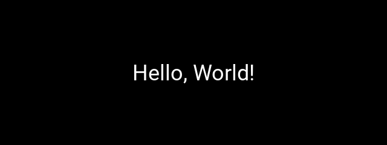

# #820 kvlang

Analyze kvlang and show a Label with greeting.

## Real Verification

Kivy 2.3.1; CPython 3.12.3; Xvfb; Mesa software GL

```text
pip install Kivy==2.3.1; xvfb-run -a python verify_render.py; aprire verification/rendered.png. Con un display attivo usare python verify_render.py.
```

Expected result: Hello, World!

**Sintassi e semantica verificate.** Builder.load_file creates the authentic Label and the Kivy loop event renders the 202x43 texture in the SDL2 window. Native screenshot and visual inspection confirm Hello, World!. The optional multitouch MTDev provider is not available; rendering and capture exceed the test with exit 0.

[Log della prova](verification/render.json). The previous syntactic test remains in [result.json](verification/result.json).



## Primary sources

- [https://kivy.org/doc/stable/api-kivy.lang.html](https://kivy.org/doc/stable/api-kivy.lang.html)
- [https://kivy.org/doc/stable/guide/lang.html](https://kivy.org/doc/stable/guide/lang.html)
- [https://kivy.org/doc/stable/api-kivy.core.window.html](https://kivy.org/doc/stable/api-kivy.core.window.html)

## Extension coverage

Each suffix maintains its own test; the pending variants do not inherit verifications.

| Extension | File and status |
| --- | --- |
| `.kv` | [hello.kv](hello.kv) syntax and behavior verified |
